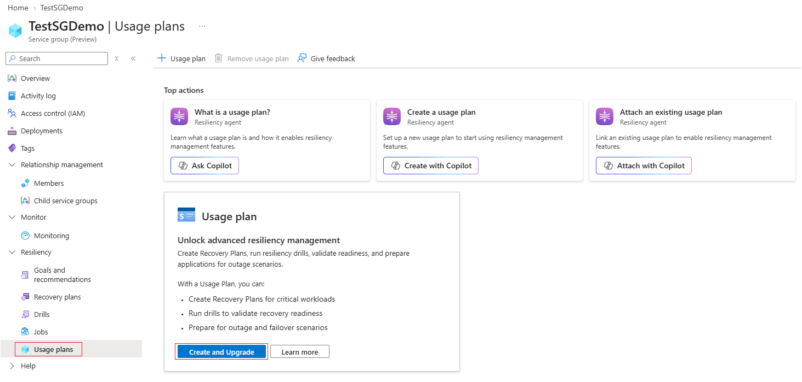
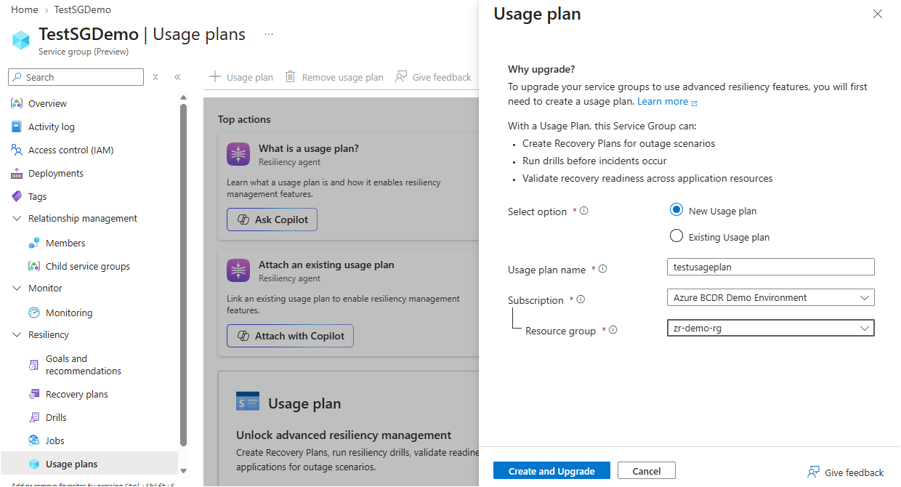

# Usage plans for Infrastructure Resiliency Manager

[Infrastructure Resiliency Manager](https://learn.microsoft.com/en-us/azure/resiliency/infrastructure-resiliency-manager-overview) provides capabilities to assess, improve, and test resilience across your Azure resources and applications. This article explains which capabilities are available at no additional cost, how usage plans determine where charges are billed, and when a service group incurs charges.

## Free and advanced capabilities

You can use the following capabilities without enrolling a service group in a usage plan:

- Assign resiliency goals to service groups that represent your applications.
- View resilience posture at scale across resources and service groups.
- Review resiliency recommendations.

Advanced capabilities, including **Drills** and **Recovery Orchestration Plans**, require a usage plan to be created. Before you set up drills or recovery plans, enroll the service group in a usage plan.

> [!IMPORTANT]
> **During the Private Preview of Regional Resiliency, there will not be any billing or charges even when you associated a usage plan with a service group. But a plan is required to use Recovery Plans and Drills features**

## Enroll a service group in a usage plan

To enroll a service group in the Azure portal, follow these steps:

1. In the [Azure portal](https://aka.ms/AzureResiliency/regionalpreview), go to **Resiliency** > **Service Groups** under the Infrastructure Resiliency section.

2. Search for and select your service group.
3. In the service group's menu, under **Resiliency**, select **Usage Plans**.

   

4. Select **Create and Upgrade**, and then choose whether to use a new usage plan or an existing usage plan:
   - **New usage plan**: Select a subscription and resource group, and enter a name for the usage plan. The subscription you select is charged for the service group's usage against this usage plan's ARM resource ID.
   - **Existing usage plan**: Select the usage plan to use for the service group. Usage is charged to the subscription associated with that plan.

5. Confirm your selection. For a new plan, this step creates the usage plan and enrolls the service group. For an existing plan, this step enrolls the service group in the selected plan.

You can repeat these steps for other service groups and select the same existing usage plan.

After enrollment, you can [define a region down drill](https://github.com/Azure/ResiliencyInAzure/blob/main/Drills/DefineAndExecuteDrill.md) or [create and configure a Recovery Orchestration Plan](https://github.com/Azure/ResiliencyInAzure/blob/main/Recovery%20plan/CreateAndExecuteRecoveryPlan.md).

> [!IMPORTANT]
> If the service group already has assigned goals, enrolling it in a valid usage plan meets both billing conditions. You don't need to create or execute a drill or recovery plan for charges to begin.

## Troubleshoot usage plan creation

If usage plan creation appears stuck, registration of the **Microsoft.AzureResilienceManagement** resource provider might not be complete in the subscription where you're creating the plan.

To complete registration and retry enrollment:

1. In the Azure portal, go to **Subscriptions** and select the subscription where you want to create the usage plan.
2. Under **Settings**, select **Resource providers**.
3. Search for **Microsoft.AzureResilienceManagement**.
4. If the provider isn't registered, select it and select **Register**. If registration is already in progress, wait for it to complete.
5. Wait until the registration status shows **Registered**.
6. Return to the service group's **Resiliency** > **Usage Plans** page and retry usage plan creation and enrollment.
